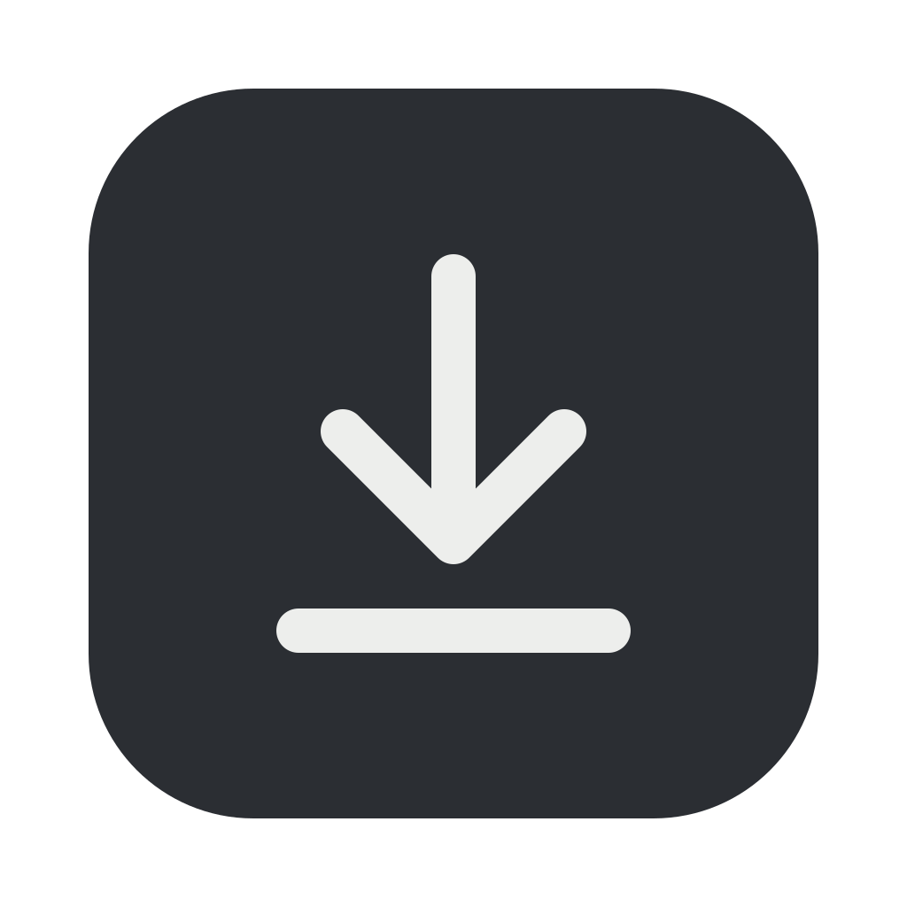
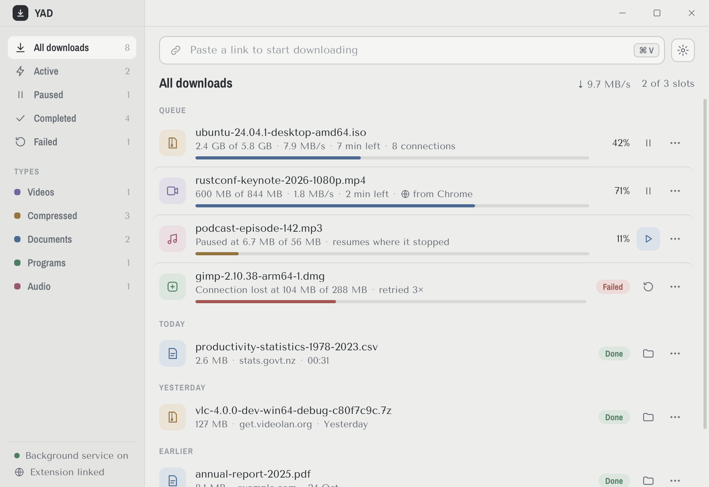
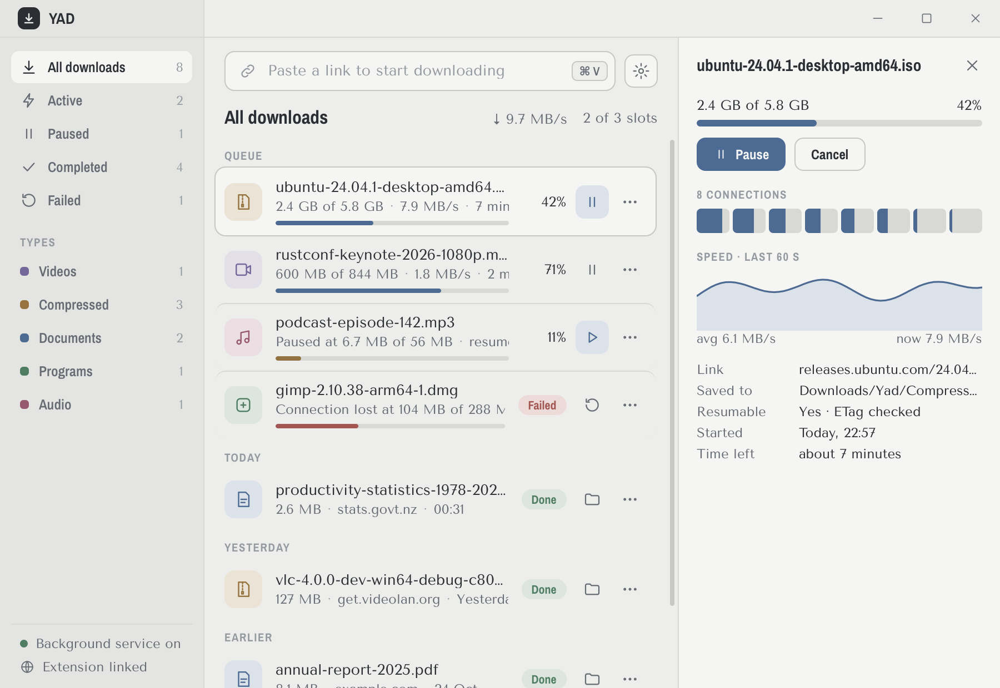
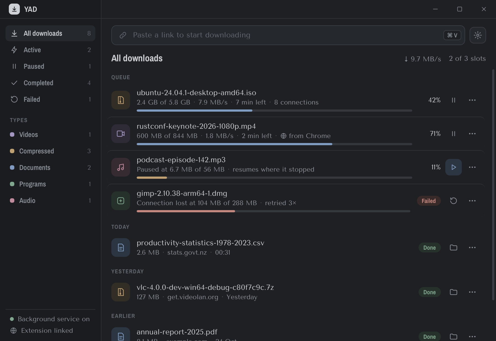
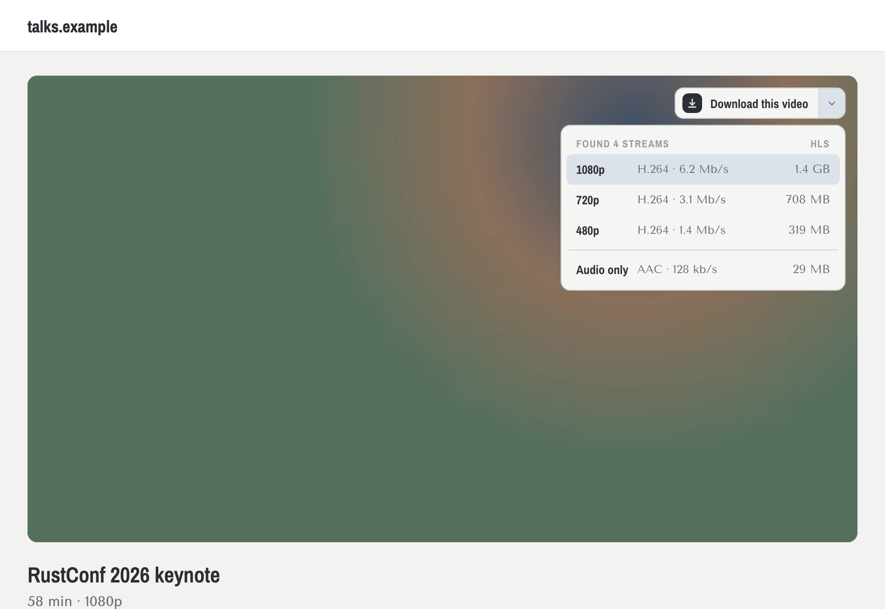
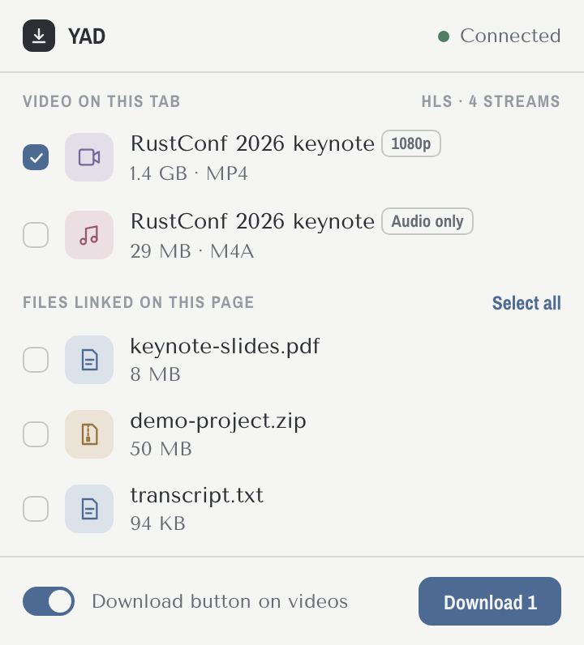
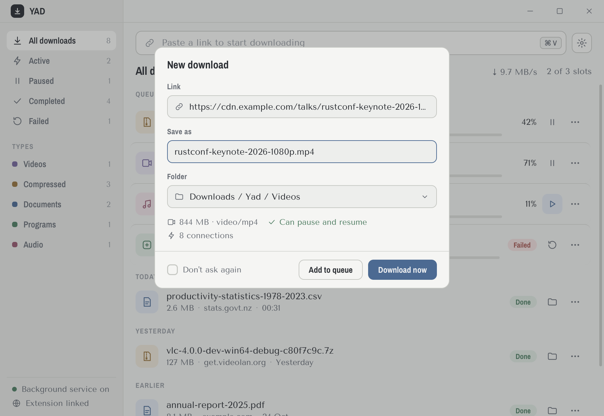
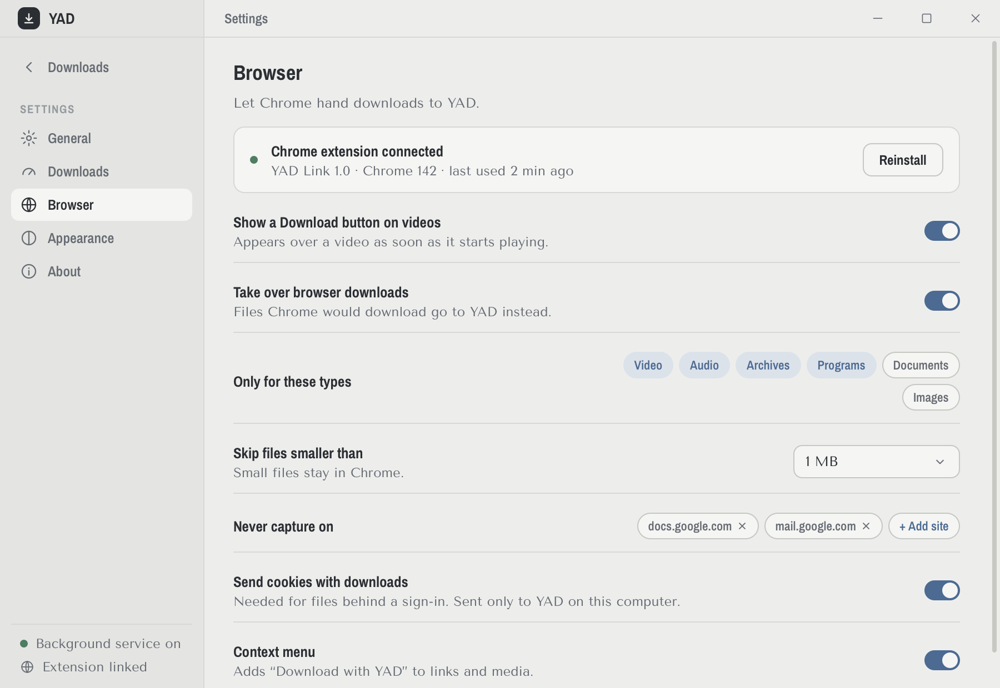
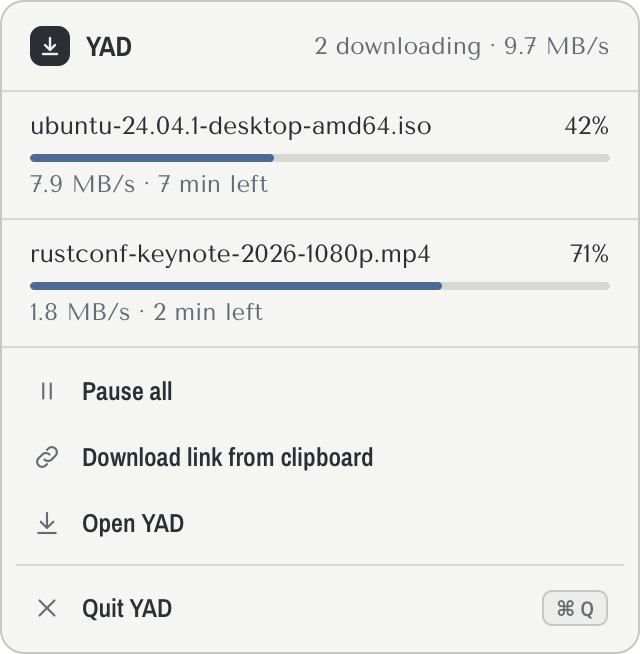
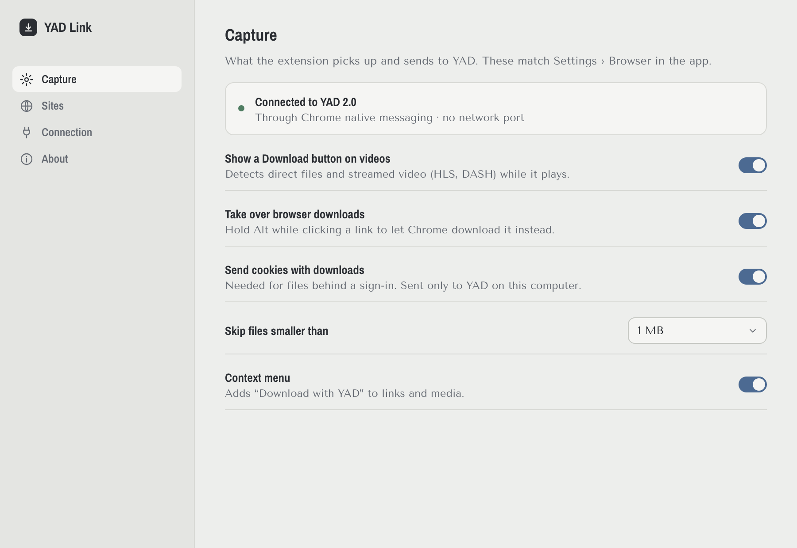

<p align="center"></p>

<h1 align="center">Yet Another Downloader</h1>

<p align="center">A fast, resumable download manager with a browser extension that saves video.</p>

<p align="center"></p>

- **Fast, resumable downloads.** Large files download over several connections. Pause, quit or lose the connection and YAD picks up where it stopped.
- **Runs in the background.** Closing the window doesn't stop downloads, and YAD can start at login.
- **Video from the browser.** The YAD Link extension puts a *Download this video* button on videos, with every quality it finds, including streamed (HLS and DASH) video.
- **Sorted for you.** Files go into `~/Downloads/Yad`, by type, unless you choose another folder.

**This is a beta. Please report bugs as [issues](https://github.com/innv8/yad/issues).**

| | |
|---|---|
|  |  |
|  |  |

<details>
<summary>More screenshots</summary>

| | |
|---|---|
|  |  |
|  |  |

</details>

## Install

Download the latest release from the [Releases page](https://github.com/innv8/yad/releases). Each release has:

- `Yet.another.Downloader_<version>_aarch64.dmg`: the app, for Macs with Apple Silicon
- `yad-link-extension-v<version>.zip`: the browser extension, at the same version
- `yadd-v<version>-macos-arm64`: the download service on its own, for servers and scripts

Windows, Linux and Intel Mac builds are made on request: [open an issue](https://github.com/innv8/yad/issues) or [build from source](#build-from-source).

### The app

1. Open the `.dmg` and drag **Yet another Downloader** into **Applications**.
2. The app isn't signed with an Apple Developer ID yet. The first time, right-click it in Applications and choose **Open**, then **Open** again.
   If macOS says it's damaged, run:
   ```sh
   xattr -dr com.apple.quarantine "/Applications/Yet another Downloader.app"
   ```
3. YAD lives in the menu bar. Closing the window keeps downloads going; quit from the menu bar icon.

Install [ffmpeg](https://ffmpeg.org) (`brew install ffmpeg`) so YAD can join streamed video and audio into one `.mp4`.

### The browser extension

1. Unzip `yad-link-extension-v<version>.zip`.
2. Open `chrome://extensions` (or `brave://extensions`, `edge://extensions`), turn on **Developer mode**, choose **Load unpacked** and pick the unzipped folder.
3. Open YAD once. The extension shows **Connected**.

Play a video and a **Download this video** button appears on it. Hold **Alt** while clicking a link to let the browser download it instead. DRM-protected video and live streams can't be downloaded.

### Uninstall

Turn off **Settings → General → Start at login**, quit YAD and delete the app. Your history and settings are in `~/Library/Application Support/Yad`; downloaded files are never deleted.

## Build from source

You need [Rust](https://rustup.rs), the [Tauri prerequisites](https://tauri.app/start/prerequisites/) and Node (for the tests and screenshots).

```sh
cargo install tauri-cli --version "^2" --locked
cargo tauri dev                       # run in development
cargo tauri build                     # build the app into target/release/bundle/

cargo test -p yad-core -p yadd        # engine and end-to-end download tests
npm ci && npm run test:ui             # the interface must look the same in Chromium and WebKit
npm run screenshots                   # refresh the images in docs/images
```

Set `YAD_CONFIG_DIR=/tmp/yad-dev` and `YAD_SKIP_NATIVE_HOST=1` while developing to keep test data away from your real downloads and browsers.

| Folder | What's in it |
|---|---|
| `crates/yad-core` | download engine, HLS/DASH, storage, IPC, start-at-login |
| `crates/yadd` | the background service and the browser's native-messaging host |
| `src-tauri`, `src` | the window (Tauri, plain HTML/CSS/JS) |
| `extension` | YAD Link, the Chrome extension |
| `docs/ipc.md` | the protocol between them |

## Releases

Every push to `main` builds the Apple Silicon app, `yadd` and the extension. A `feat:` or `fix:` commit also bumps the version and publishes a release. Other platforms are built by hand from **Actions → Build other platforms**.

## Contributing

See [reporting bugs](./.github/ISSUE_TEMPLATE/bug_report.md), [requesting features](./.github/ISSUE_TEMPLATE/feature_request.md), [how to contribute](./.github/CONTRIBUTING.md) and [making a pull request](./.github/pull_request_template.md).

Released under the [Apache 2.0 license](./LICENSE); see also the [Notice](./NOTICE). Read more about how this was made at [innv8.ke](https://innv8.ke), and see [@rapando](https://github.com/rapando) on GitHub.
